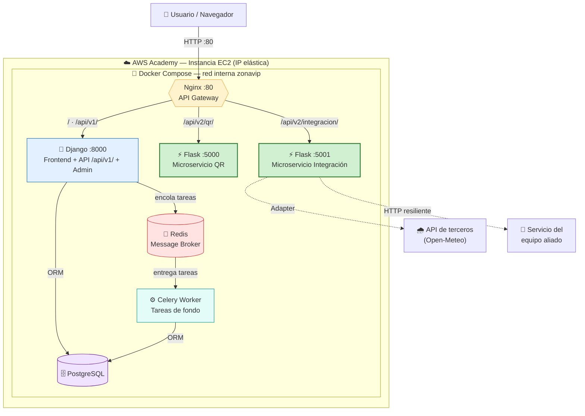

# Entrega 2 — Migración a Microservicios, Integración y Resiliencia

**Curso:** Arquitectura de Software 2026 — Prof. Nicolás Ramírez Vélez
**Entrega:** No. 2 — Ecosistema híbrido y resiliente desplegado en AWS Academy

Esta página documenta la evolución de ZonaVip desde el monolito Django hacia un
**ecosistema híbrido y resiliente**: dos microservicios Flask estrangulados, un
API Gateway (Nginx), comunicación asíncrona (Celery + Redis), integración entre
servicios/terceros vía **Patrón Adapter** e **i18n** bilingüe completo.

---

## 1. Diagrama de la arquitectura (AWS + Nginx + Flask + Broker)



**Flujo:** el usuario entra siempre por Nginx (puerto 80, única superficie
expuesta en EC2). Nginx enruta según la URL hacia el monolito o los
microservicios. Las tareas pesadas se encolan en Redis y las procesa el worker
de Celery por fuera del ciclo request/response. El microservicio de integración
consume una API de terceros (vía Adapter) y el servicio del equipo aliado.

---

## 2. Servicios (API, aliado y terceros vía Adapter)

Toda la integración se concentró en un **segundo microservicio estrangulado**:
`services/integracion_service/` (Flask).

| Requisito | Endpoint (tras Nginx) | Implementación |
|---|---|---|
| **Servicio a proveer** | `GET /api/v2/integracion/info` | JSON con metadata del sistema para que el aliado lo consuma |
| **Consumo de terceros (Adapter)** | `GET /api/v2/integracion/clima` | Clima de la sede vía `OpenMeteoAdapter` |
| **Consumo del aliado** | `GET /api/v2/integracion/aliado` | `AliadoHttpAdapter` resiliente (URL por env var) |

### Patrón Adapter + Inversión de Dependencias

```
application/services.py  ──depende de──►  domain/ports.py  (interfaces)
                                                 ▲
                                                 │ implementan
                          ┌──────────────────────┴───────────────────────┐
          infra/open_meteo_adapter.py                    infra/aliado_adapter.py
          (API de terceros: Open-Meteo)                  (servicio del aliado)
```

El núcleo de la aplicación **solo conoce las interfaces** (`ProveedorClimaPort`,
`ServicioAliadoPort`). Los adaptadores concretos traducen el formato externo al
modelo de dominio y se inyectan en `crear_app()`. Cambiar de proveedor de clima
o de URL del aliado **no toca la lógica de negocio** — es la Inversión de
Dependencias exigida por la rúbrica.

> **Resiliencia:** `AliadoHttpAdapter` degrada con elegancia. Si el aliado no
> responde (timeout/5xx/red caída), no lanza excepción: devuelve
> `{"disponible": false, "error": "..."}` para que la UI no se rompa.

---

## 3. Comunicación asíncrona (Celery + Redis)

Redis actúa como **Message Broker**. Las tareas de fondo (reportes de ventas,
notificaciones masivas) se definen en `apps/reportes/tasks.py` y las ejecuta un
**worker de Celery** independiente del proceso web.

| Endpoint | Acción |
|---|---|
| `POST /api/v1/reportes/ventas/` | Encola el reporte → `202 Accepted` + `task_id` |
| `POST /api/v1/notificaciones/` | Encola una notificación masiva |
| `GET /api/v1/tareas/<task_id>/` | Consulta estado/resultado de la tarea |

**Por qué asíncrono:** en un monolito síncrono, un reporte pesado bloquea el
worker WSGI y causa *timeouts*. Al encolarlo en Celery, la petición responde de
inmediato y el cálculo ocurre en segundo plano. El frontend consulta el estado
por *polling* y muestra el resultado cuando está listo.

---

## 4. Internacionalización (i18n)

Soporte **bilingüe completo ES/EN** mediante `gettext`. **No hay textos
quemados**: todos los textos de la UI se marcan con `` / `gettext()`
y se traducen en los catálogos `locale/<idioma>/LC_MESSAGES/django.po`.

- `LocaleMiddleware` detecta el idioma (sesión / cookie / `Accept-Language`).
- El selector **ES/EN** del navbar hace `POST /i18n/setlang/`.
- Los catálogos se compilan a `.mo` en el build de la imagen Docker.

---

## 5. Frontend (usabilidad y UX)

Interfaz moderna en `interfaces/web/` construida con **Tailwind CSS** +
**Alpine.js** (cero paso de build — ideal para EC2):

- **Landing** (`/`): hero animado + catálogo de eventos en tarjetas.
- **Panel** (`/panel/`): vitrina de la Entrega 2 — consume en vivo el clima
  (terceros), la info del sistema, el servicio del aliado y dispara el reporte
  asíncrono, todo desde el mismo origen vía Nginx.
- **Modo oscuro**, diseño responsive, selector de idioma, estados de carga y
  manejo de errores en la UI (usabilidad robusta).

---

## 6. Infraestructura y despliegue (AWS Academy)

Todo el ecosistema está orquestado con **Docker Compose**:

| Servicio | Imagen / Build | Rol |
|---|---|---|
| `nginx` | nginx:1.27-alpine | API Gateway (puerto 80) |
| `django_web` | build `./Dockerfile` | Monolito + frontend + API |
| `celery_worker` | build `./Dockerfile` | Tareas asíncronas |
| `flask_qr_service` | build `./services/qr_service` | Microservicio QR |
| `flask_integracion` | build `./services/integracion_service` | Microservicio Integración |
| `db` | postgres:16-alpine | Base de datos |
| `redis` | redis:7-alpine | Message Broker |

El paso a paso para desplegar en una instancia **EC2 de AWS Academy** está en
[`docs/DEPLOY_AWS.md`](../DEPLOY_AWS.md).

```bash
# En la instancia EC2:
git clone <repo> && cd ZonaVip---T-picos-ing.-de-software
docker compose up --build -d
# La app queda disponible en http://<IP-elastica>/
```

---

## 7. Mapa de la rúbrica → evidencia

| Criterio (peso) | Dónde está |
|---|---|
| **Correcciones E1** (10%) | Sin correcciones pendientes de la Entrega 1 |
| **Arquitectura** (10%) | Diagrama de esta página (AWS + Nginx + Flask + Broker) |
| **Servicios** (30%) | `services/integracion_service/` (API + aliado + Adapter) |
| **Infraestructura** (30%) | `docker-compose.yml` + `infra/nginx/nginx.conf` + `docs/DEPLOY_AWS.md` |
| **Resiliencia y UX** (20%) | i18n (`locale/`), frontend (`interfaces/web/`), async (`apps/reportes/tasks.py`) |

### Hacia el Bono de Excelencia (>70% en microservicios)

Ya hay **dos microservicios** independientes (QR + Integración). El siguiente
corte natural es **Pagos** (`PasarelaPagoFactory`), que llevaría la lógica de
negocio migrada por encima del umbral del bono.
